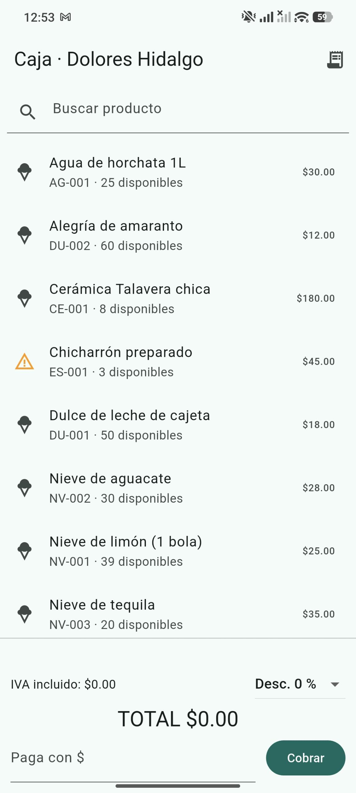
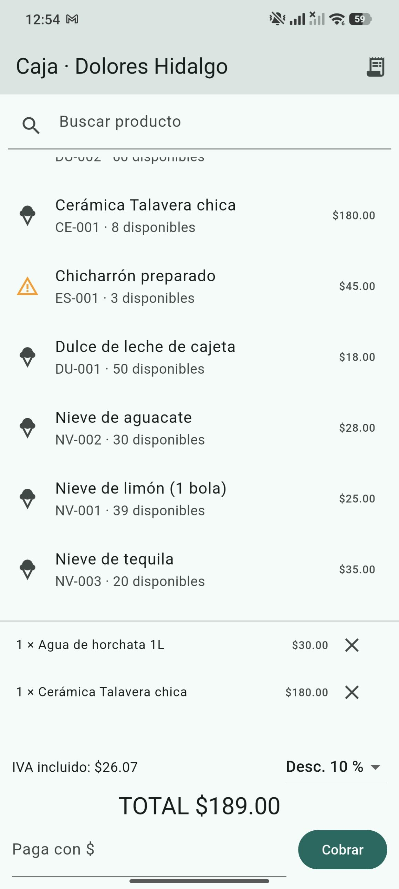
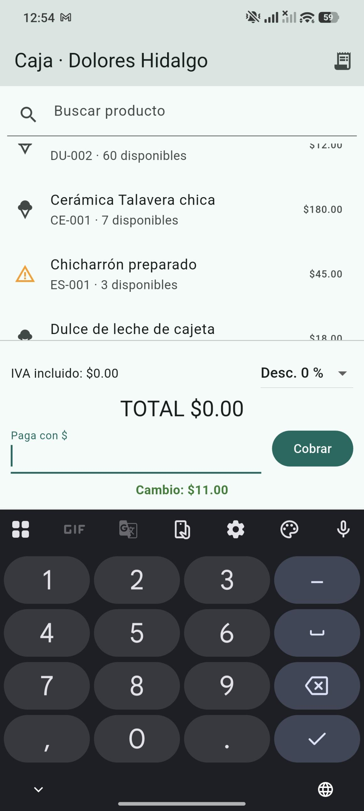
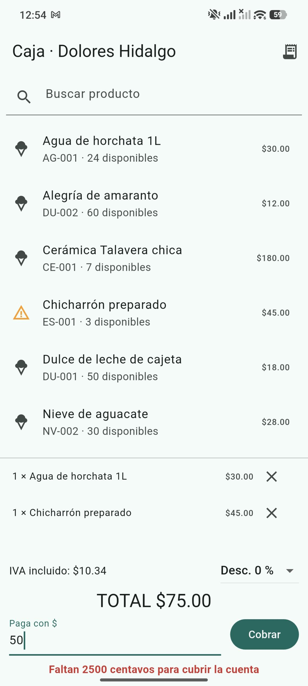
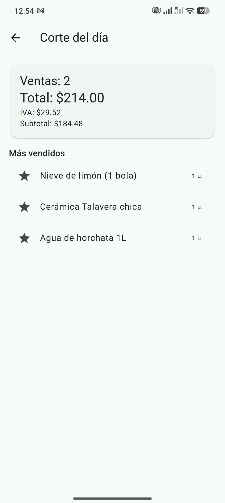

# Punto de Venta Dolorense — Flutter + SQLite con TDD

Caja para la nevería de la plaza: catálogo, carrito, **IVA incluido desglosado**, cobro con cambio, inventario que se
descuenta en una **transacción SQLite** y **corte del día** con los más vendidos. Funciona sin internet. Construido con
**TDD** en 3 capas (dominio puro, datos con SQLite en memoria y ViewModel) siguiendo el *Manual paso a paso con TDD —
Punto de Venta*. Todo el dinero se maneja en **centavos enteros**, nunca `double`.

**Retos del manual incluidos:** `.5` y negativos, descuento por porcentaje, bajo inventario, vender las 5 y luego 1
más (la transacción revalida), pantalla de **Corte del día**.

---

## 📦 APK

| Archivo | Ruta |
|---|---|
| Lista para instalar | `apk/PuntoDeVentaDolores.apk` (16.2 MB) |
| Salida de Flutter | `build/app/outputs/flutter-apk/app-release.apk` |

```bash
flutter build apk --release --target-platform android-arm64
```

El APK es para teléfonos **arm64** (prácticamente todos los Android de los últimos años). Para instalar: copia el `.apk` al teléfono, ábrelo y acepta *instalar apps de origen desconocido*.

---

## 🏗️ Estructura

```text
lib/
├── dominio/        dinero · producto · carrito (IVA, cambio, descuento) · venta · excepciones   (Dart puro)
├── datos/          base_datos · repositorio_productos · repositorio_ventas (transacción, corte, más vendidos)
├── presentacion/   caja_viewmodel · pantalla_caja · pantalla_corte
└── main.dart       raíz de composición
test/
├── dominio_test.dart   dinero, producto, carrito
└── datos_test.dart     SQLite en memoria (sqflite_common_ffi) + ViewModel
```

---

## 🔴🟢🔵 Evidencia del ciclo TDD

### 1. 🔴 ROJO — las pruebas se escriben primero y fallan

Las pruebas de `test/` se escribieron **antes** que el código. Al correr `flutter test` con `lib/` todavía vacía, nada compila.

### 2. ❌ Error real atrapado por una prueba

La primera versión de `pesosACentavos` tomaba la parte decimal tal cual:

```dart
cents = int.parse(partes[1]);      // ❌ "12.5" → 12 pesos y 5 centavos
```

El cajero escribe `12.5` y el sistema cobra **$12.05** en lugar de **$12.50**. Es el "error clásico de principiante"
que el manual pide vigilar; la prueba lo atrapó (esperaba 1250, obtuvo 1205) y también el reto `.5` → 50.

**Corrección:** rellenar a dos dígitos antes de convertir:

```dart
final c = int.tryParse(partes[1].padRight(2, '0').substring(0, 2));   // ✅ "5" → "50"
```

### 3. 🔵 REFACTOR — limpiar sin romper nada

Con las pruebas en verde se ordenó el código y `flutter analyze` quedó sin avisos.

### 4. 🟢 VERDE — las 33 pruebas pasan

Las 33 pruebas del proyecto pasan tras completar el ciclo de desarrollo y correcciones.

### 5. 📦 Compilación del APK

El APK de liberación se compila en modo `release` para `android-arm64`.

---

## ✅ Qué cubren las pruebas

| Grupo | Lo que se verifica |
|---|---|
| Dinero | `$1,234.56`, negativos, texto → centavos (`12.5`, `$1,200`, `.5`), rechaza texto inválido |
| Carrito | suma cantidades, no excede existencias y **queda intacto si falla**, IVA 16% = $13.79 de $100, cambio, pago corto, vacío, descuento |
| SQLite | guardar/buscar, código duplicado → excepción de dominio, filtro, bajo inventario |
| Transacción | cobrar descuenta inventario; si falla **no** descuenta; revalida existencias contra la base |
| Corte | suma solo las ventas del día, otro día da 0, ranking de más vendidos |
| ViewModel | cobrar con texto y cambio, pago corto, agregar de más, monto inválido con mensaje amable |

```bash
flutter test
```

---

## 📱 Capturas de la app

> Tomadas en un teléfono físico con el APK instalado. *Guarda tus capturas en `capturas/` con estos nombres y aparecerán aquí automáticamente.*

| Catálogo | Carrito con IVA | Cobro con cambio |
|---|---|---|
|  |  |  |

| Error: pago insuficiente | Error: no hay existencias | Corte del día |
|---|---|---|
|  |  |  |

### Qué probar en la app

| Caso | Qué hacer | Resultado esperado |
|---|---|---|
| Venta normal | Toca 2 veces "Nieve de limón", paga `100` | "Cambio: $50.00" y existencias 40 → 38 |
| Decimales | Paga `60.5` por $55.00 | "Cambio: $5.50" |
| Pago corto | Paga `10` por $25.00 | "Faltan 1500 centavos para cubrir la cuenta" |
| Sin existencias | Agrega 4 "Chicharrón preparado" (hay 3) | "Solo quedan 3 de Chicharrón preparado" |
| Descuento | Elige "Desc. 10 %" | El total baja 10% y el IVA se recalcula |
| Corte | Ícono 🧾 arriba a la derecha | Ventas, total, IVA y más vendidos de hoy |

---

## 🛠️ Cómo correr el proyecto

```bash
flutter pub get
```

```bash
flutter test
```

```bash
flutter run
```

Los datos viven en un archivo SQLite dentro del teléfono: si cierras la app, siguen ahí. Para empezar de cero,
desinstala la app.
